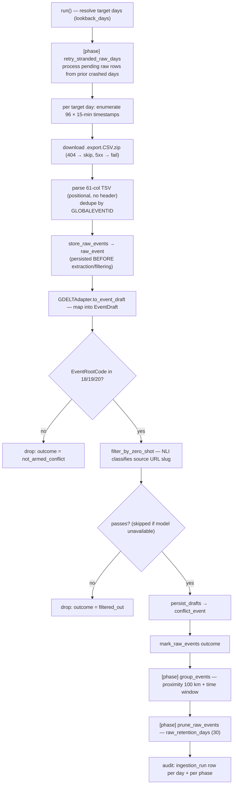
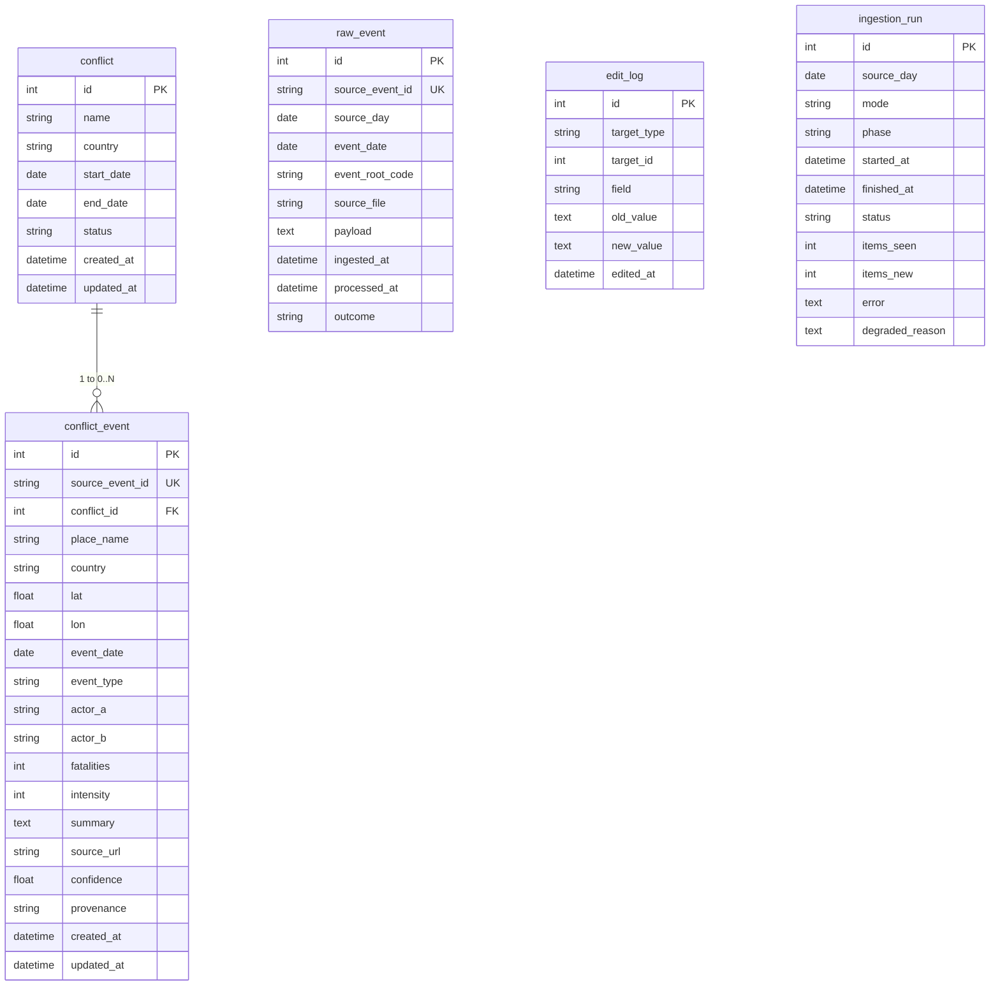
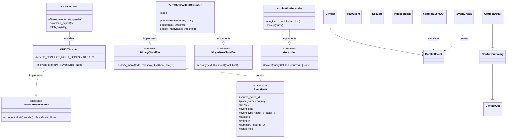
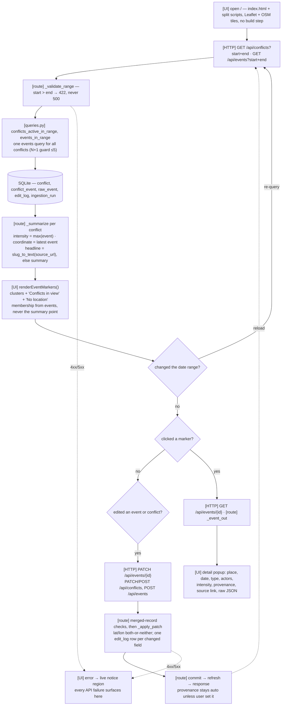

# Diagrams

Mermaid sources for the architecture. Each block renders inline on GitHub and in any
Mermaid renderer (mermaid.live, or `mmdc -i in.mmd -o out.svg`). They are plain text, so
they diff and review like code.

| Diagram | Shows | Derived from |
|---|---|---|
| Architecture | Module boundaries and the runtime data flow between them | `../CAPABILITY-MAP.md` |
| Daily pipeline | The daily run: fetch → filter → persist → group, with both gates | `../SPEC-ingestion.md`, `../SPEC-extraction.md`, `app/extract/run.py` |
| Schema | The five tables, their keys, and the one real foreign key | `app/models.py`, `../SPEC-storage.md` |
| Classes | The adapter and classifier seams, the ORM models, and the API schema hierarchy | `app/extract/base.py`, `app/extract/classifier.py`, `app/models.py`, `app/api/schemas.py` |
| Request flow | What one page load, date scrub, marker click, or edit actually does | `app/api/routes.py`, `app/queries.py`, `app/static/app.js` |

## Architecture

```mermaid
flowchart LR
  model["Zero-shot NLI model<br/>transformers + torch (CPU)<br/>degrades gracefully if absent"]
  gdelt[("GDELT 2.0<br/>15-min .export.CSV.zip<br/>61-col TSV, no header")]
  ingestion["ingestion<br/>app/ingest/ gdelt.py · normalizer.py · raw_store.py<br/>download → normalize → dedupe"]
  extraction["extraction<br/>app/extract/<br/>BaseSourceAdapter (swappable)<br/>filter · map · intensity · group"]
  storage[("storage<br/>SQLite · SQLAlchemy 2.0<br/>models.py · queries.py · db.py<br/>5 tables + read helpers")]
  api["api<br/>app/api/ routes.py · schemas.py<br/>FastAPI /api/* · manual edit/create"]
  ui["ui<br/>app/static/ index.html · map.js/state.js/list.js/detail.js · app.js wiring<br/>Leaflet map + time scrub"]
  browser["Browser<br/>Leaflet + OSM tiles<br/>no build step"]

  gdelt -->|download| ingestion
  ingestion -->|raw rows| extraction
  extraction -->|drafts| storage
  storage -->|queries| api
  api -->|JSON| ui
  ui -->|static| browser
  model -.->|filter_by_zero_shot (degradable)| extraction
  browser -.->|manual edits (PATCH/POST)| api
```

Dependency direction is one-way (build order): `storage → ingestion → extraction → api → ui`.
Extraction is the swappable source boundary — GDELT now, T5/LLM later via `BaseSourceAdapter`.
Adapters stay pure: no DB or HTTP inside `gdelt_adapter.py` / `base.py`.

## Daily pipeline



## Schema



## Classes



## Request flow



## What the diagrams assert

- **Architecture** — dependency runs one way, `storage → ingestion → extraction →
  api → ui`, so build follows the same order. Extraction is a swappable boundary: the
  zero-shot gate hangs off it as a dashed (degradable) dependency, and manual edits run
  back from the browser to the API.
- **Daily pipeline** — `raw_event` is written *before* extraction and filtering, so a
  failed run leaves replayable rows. The two gates are the CAMEO root-code allow-list
  (`{18, 19, 20}`) and the zero-shot semantic filter, which is skipped — not failed — when
  the model is unavailable. `group_events` and `prune_raw_events` run after the per-day
  loop; each gets its own `ingestion_run` row.
- **Schema** — `conflict_event → conflict` is the only foreign key. `edit_log`
  points at its target by `target_type` + `target_id` with no FK, and `raw_event` /
  `ingestion_run` stand alone.
- **Classes** — `BaseSourceAdapter.to_event_draft` is the one method a replacement
  source must implement, and it may not touch the DB or HTTP. The classifier and geocoder
  seams are `Protocol`s rather than abstract classes, because typing against the concrete
  class made every test stub a type error. The schema chain `ConflictOut → ConflictSummary
  → ConflictDetail` is inheritance, not duplication: detail adds only `events`.
- **Request flow** — the map is drawn from *events*, and `_summarize` decides each
  conflict's single summary point as its latest event in range. That is why the sidebar
  tests membership against the events rather than that point. `_apply_patch` writes one
  `edit_log` row per field that actually changed, and lat/lon are validated on the merged
  record (both or neither), never on the partial payload alone.

## Keeping them honest

The diagrams restate the specs, so a spec change that isn't mirrored here leaves a
diagram that lies. When `EventDraft`, the grouping rule, the schema, or an endpoint
changes, update the matching block in the same change.
